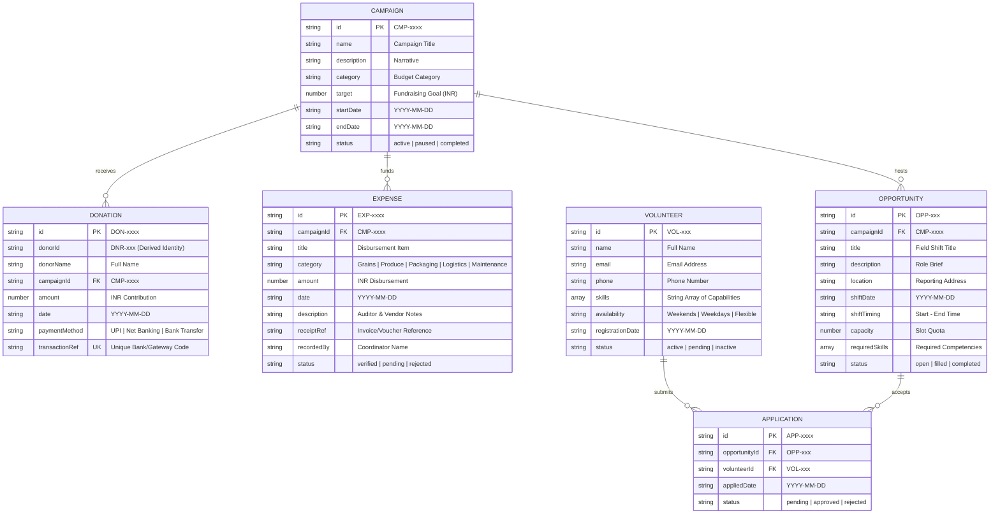

# GiveTrack — Data Model & Architecture Specification (Lab 3)

**Domain:** Non-Governmental Organization (NGO) Donation Transparency, Expense Verification, and Volunteer Skill Matching  
**Platform:** GiveTrack  
**Tagline:** *Every Contribution. Accounted For.*  
**Standard:** 100% Vanilla JavaScript (ES6+), Clean Separation of Concerns  
**Execution Context:** Client-Side Educational Prototype (`localStorage` Simulated Persistence)  

---

## 1. Overview & Data Philosophy

GiveTrack implements a deterministic non-profit financial accounting demonstration model. To ensure complete public transparency and rigorous governance in accordance with standard non-profit accounting principles, the application enforces strict relational integrity between donor contributions, expenditure vouchers, campaign targets, and volunteer deployments.

### Client-Side Educational Prototype Scope
All persistent entities are stored client-side in browser `localStorage` under isolated namespace keys (`givetrack_*_v3`). As an academic demonstration prototype, the platform does not process real payment gateway transactions, hold funds in bank custody, or connect to external SQL/NoSQL databases. All data, vouchers, receipt references, and audit checks represent illustrative demonstration data.

### Core Mathematical Invariant
For any individual campaign $c$ and globally across all campaigns:
$$\text{Total Contributions Received} = \sum \text{Verified Disbursements} + \text{Remaining Uncommitted Reserve}$$

Disbursements are categorised into three audit states:
1. **Verified (`verified`):** Formally matched against vendor receipts; immediately deducted from available campaign funds.
2. **Pending (`pending`):** Held in uncommitted reserve awaiting receipt verification; **zero** funds disbursed until verified.
3. **Rejected (`rejected`):** Disallowed by review under standard NGO procurement guidelines; **zero** funds disbursed.

### Donor Identity Derivation & Continuity Rule
GiveTrack does **not** persist a standalone `DONORS` table. Instead, donor identities are derived directly from `DONATION` records via `donorId` and `donorName`. To preserve historical contribution tracking and prevent profile fragmentation, when a donor contributes multiple times, their identity is matched against existing donations (case-insensitively). Their canonical `donorId` (e.g., `DNR-101`) is preserved across repeat donations rather than generating an orphaned ID each time.

---

## 2. Entity Relationship Diagram



---

## 3. Entity Data Specifications

### 3.1. Campaign (`createCampaign`)
Represents an authorized public welfare initiative managed by the foundation.

| Field Name | Type | Constraints / Rules | Description |
| :--- | :--- | :--- | :--- |
| `id` | `string` | Primary Key, `CMP-` prefix, unique | Unique initiative identifier |
| `name` | `string` | Required, min 3 chars | Public initiative title |
| `description` | `string` | Required | Narrative background and target beneficiaries |
| `category` | `string` | Enum: Food & Nutrition, Education, Healthcare, Environment | Programme classification |
| `target` | `number` | Positive integer, $> 0$ | Total fundraising target in INR |
| `startDate` | `string` | ISO Date `YYYY-MM-DD` | Inception date |
| `endDate` | `string` | ISO Date `YYYY-MM-DD`, $\ge \text{startDate}$ | Planned completion date |
| `status` | `string` | Enum: `active`, `paused`, `completed` | Operational status |

```json
{
  "id": "CMP-CFSP-01",
  "name": "Community Food Support Programme (Bengaluru Hub)",
  "description": "Providing 320 monthly nutrition kits, fortified grains, and warm meals for underserved urban families.",
  "category": "Food & Nutrition",
  "target": 150000,
  "startDate": "2026-10-01",
  "endDate": "2026-12-31",
  "status": "active"
}
```

---

### 3.2. Donation (`createDonation`)
Represents an individual donor contribution. Donors are uniquely tracked via `donorId` and `donorName` directly within this entity.

| Field Name | Type | Constraints / Rules | Description |
| :--- | :--- | :--- | :--- |
| `id` | `string` | Primary Key, `DON-` prefix | Ledger transaction ID |
| `donorId` | `string` | Derived Donor Reference (`DNR-xxx`) | Preserved canonical donor ID across repeat contributions |
| `donorName` | `string` | Required, min 2 chars | Donor's full legal/display name |
| `campaignId` | `string` | Foreign Key to `Campaign.id` | Target initiative |
| `amount` | `number` | Positive integer, $> 0$ | Monetary contribution in INR |
| `date` | `string` | ISO Date `YYYY-MM-DD` | Date of simulated contribution |
| `paymentMethod` | `string` | Enum: `UPI Transfer (Demo)`, `Net Banking (Demo)`, `Debit Card (Demo)` | Payment instrument |
| `transactionRef` | `string` | Required, min 5 chars, **Globally Unique via `Set`** | Unique transaction reference string |

```json
{
  "id": "DON-2026-001",
  "donorId": "DNR-101",
  "donorName": "Aarav Sharma",
  "campaignId": "CMP-CFSP-01",
  "amount": 25000,
  "date": "2026-10-05",
  "paymentMethod": "UPI Transfer (Demo)",
  "transactionRef": "TXN-UPI-992014"
}
```

---

### 3.3. Expense (`createExpense`)
Represents an illustrative expense voucher claim against an initiative's available funds.

| Field Name | Type | Constraints / Rules | Description |
| :--- | :--- | :--- | :--- |
| `id` | `string` | Primary Key, `EXP-` prefix | Voucher reference code |
| `campaignId` | `string` | Foreign Key to `Campaign.id` | Campaign funding the expense |
| `title` | `string` | Required, min 3 chars | Disbursement description |
| `category` | `string` | Enum: Grains & Pulses, Produce, Packaging, Logistics, Maintenance, Educational Material, Medical Supplies, Horticulture | Budget line-item |
| `amount` | `number` | Positive integer, $\le \text{Available Campaign Balance}$ | Claimed disbursement in INR |
| `date` | `string` | ISO Date `YYYY-MM-DD` | Date of disbursement |
| `description` | `string` | Optional text | Vendor notes and line-item details |
| `receiptRef` | `string` | Alphanumeric or empty string | Vendor invoice / bill number |
| `recordedBy` | `string` | Coordinator title | Authorized staff member logging voucher |
| `status` | `string` | Enum: `verified`, `pending`, `rejected` | Audit verification status |

```json
{
  "id": "EXP-CFSP-01",
  "campaignId": "CMP-CFSP-01",
  "title": "Bulk Fortified Rice & Lentils (3,000 kg)",
  "category": "Grains & Pulses",
  "amount": 40000,
  "date": "2026-11-02",
  "description": "Bulk purchase of certified fortified grains for nutrition kit assembly.",
  "receiptRef": "INV-BLR-8841",
  "recordedBy": "Logistics Hub Lead",
  "status": "verified"
}
```

---

### 3.4. Volunteer (`createVolunteer`)
Represents a community volunteer registered on the platform.

| Field Name | Type | Constraints / Rules | Description |
| :--- | :--- | :--- | :--- |
| `id` | `string` | Primary Key, `VOL-` prefix | Unique volunteer roster number |
| `name` | `string` | Required, min 2 chars | Full name |
| `email` | `string` | Valid email format (`@`) | Contact email |
| `phone` | `string` | Phone format | Contact phone |
| `skills` | `Array<string>` | Normalized strings, indexed in `uniqueVolunteerSkills` Set | Registered capabilities |
| `availability` | `string` | Enum: Weekends, Weekdays, Flexible | Preferred volunteer window |
| `registrationDate` | `string` | ISO Date `YYYY-MM-DD` | Registration date |
| `status` | `string` | Enum: `active`, `pending`, `inactive` | Availability status |

```json
{
  "id": "VOL-001",
  "name": "Ananya Deshmukh",
  "email": "ananya.d@example.org",
  "phone": "+91 98765 43210",
  "skills": ["Ration Assembly", "Inventory Tracking", "Food Handling", "First Aid"],
  "availability": "Weekends",
  "registrationDate": "2026-09-01",
  "status": "active"
}
```

---

### 3.5. Opportunity (`createOpportunity`)
Represents a scheduled field shift or volunteering opportunity.

| Field Name | Type | Constraints / Rules | Description |
| :--- | :--- | :--- | :--- |
| `id` | `string` | Primary Key, `OPP-` prefix | Shift opportunity code |
| `campaignId` | `string` | Foreign Key to `Campaign.id` | Host campaign |
| `title` | `string` | Required | Shift title |
| `description` | `string` | Role description | Field duties description |
| `location` | `string` | Address string | Physical reporting address |
| `shiftDate` | `string` | ISO Date `YYYY-MM-DD` | Shift execution date |
| `shiftTiming` | `string` | Time window (e.g. `08:00 - 13:00`) | Operational hours |
| `capacity` | `number` | Positive integer | Slot capacity |
| `requiredSkills` | `Array<string>` | Required competencies | Skill prerequisites |
| `status` | `string` | Enum: `open`, `filled`, `completed` | Opportunity status |

---

### 3.6. Application (`createApplication`)
Represents a volunteer enrollment for a specific opportunity shift.

| Field Name | Type | Constraints / Rules | Description |
| :--- | :--- | :--- | :--- |
| `id` | `string` | Primary Key, `APP-` prefix | Application record ID |
| `opportunityId` | `string` | Foreign Key to `Opportunity.id` | Target opportunity |
| `volunteerId` | `string` | Foreign Key to `Volunteer.id` | Enrolled volunteer |
| `appliedDate` | `string` | ISO Date `YYYY-MM-DD` | Enrollment timestamp |
| `status` | `string` | Enum: `pending`, `approved`, `rejected` | Enrollment status |

**Duplicate Prevention:** A composite key `${volunteerId}_${opportunityId}` is tracked inside `AppState.volunteerApplicationKeys` (`Set<string>`). Duplicate enrollments are rejected immediately at submission time.

---

## 4. Key Relationships & Referential Integrity Rules

1. **Deficit Protection Guard:** An expense voucher cannot be recorded if `amount > availableBalance` where `availableBalance = raised - verifiedSpent`.
2. **Safe Archival Protection Guard:** A campaign cannot be deleted if any donation or expense ledger transactions reference its `id`.
3. **Unique Transaction Code Enforcement:** Every donation's transaction reference is tracked in `AppState.uniqueTxRefs` (`Set<string>`). Attempting to submit a duplicate transaction reference throws an immediate validation error.
4. **Shift Capacity Enforcement:** When `approvedApplications >= capacity`, an opportunity transitions to `status = 'closed'` and enrollment buttons are disabled.
5. **Donor Continuity:** When creating or editing donations, `donorName` is looked up across existing donations; matching donors retain their canonical `donorId` to maintain relationship history without a separate donor database table.
